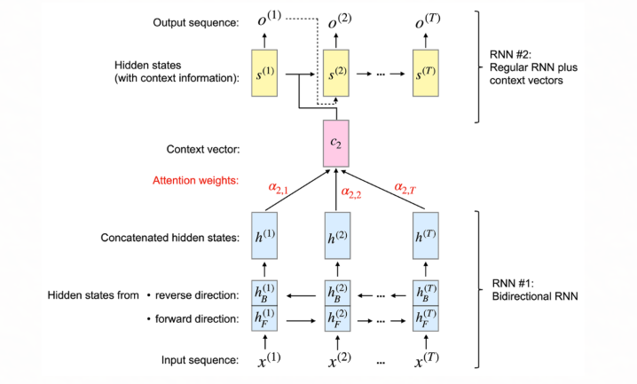
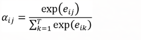
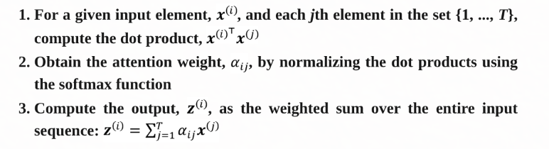
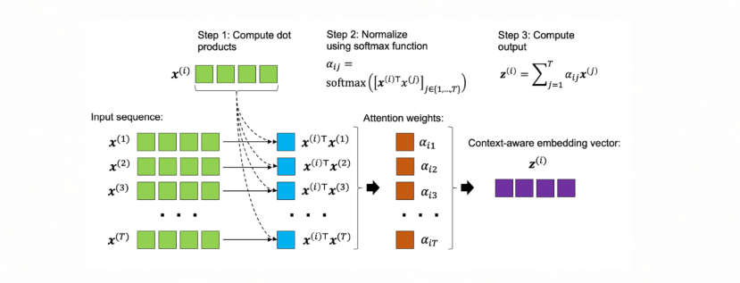
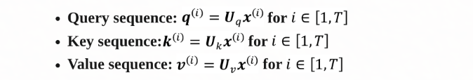
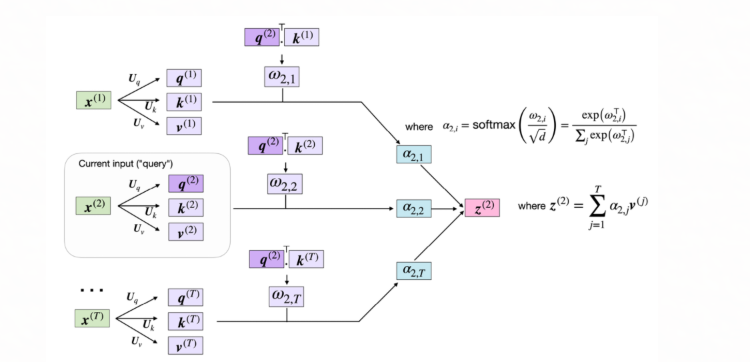
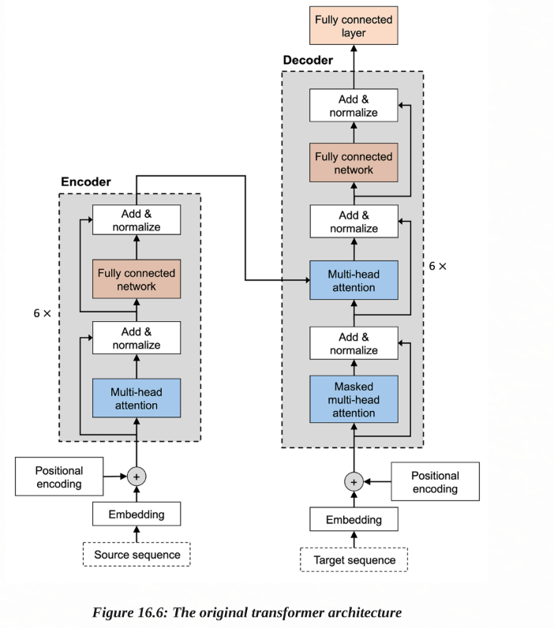

In this repo we are going to cover about : 
1. Improving RNNs with an attention mechanism
2. Introducing the stand-alone self-attention mechanism
3. Understanding the original transformer architecture
4. Comparing transformer-based large-scale language models
5. Fine-tuning BERT for sentiment classification

# Adding an attention mechanishm in rnn
some of the vital links to go about first:
Neural Machine Translation by Jointly Learning to Align and Translate by Bahdanau, D., Cho, K., and Bengio, Y., 2014, https://arxiv.org/abs/1409.0473.

self attention operatrion

here is more simplified version:

# Parameterizing the self-attention mechanism: scaled dot-product attention
note the above self attention has limitationi n terms of evaluation , to make them more flexible we will introduce three additional weight matrices that can fit as models  parameter during model training:

in the folowing image we will compute context aware  embedding vector that correspods to secon input element:

and please note the terms below:
query: the question 
key: what will be matched by query to find  certain ...
values : to be retrieved

# Original Transformer Architecure
The transformer architecture was first proposed in the NeurIPS 2017 paper Attention Is All You Need by A. Vaswani and colleagues (https://arxiv.org/abs/1706.03762)

# Encoding context embeddings via multi-head attention