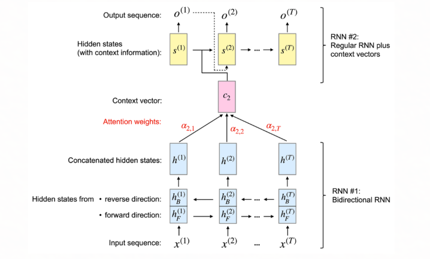
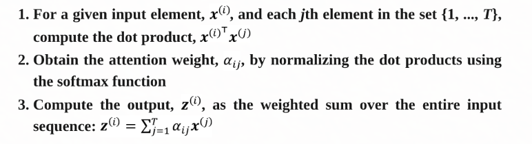
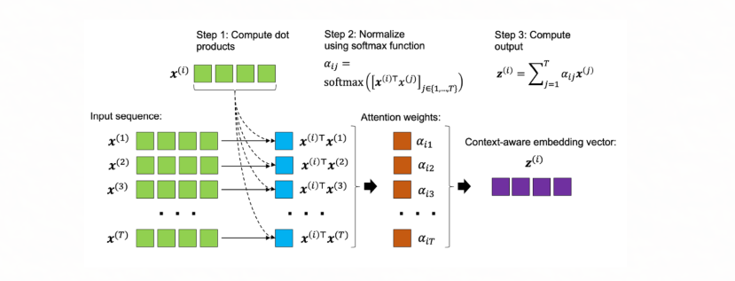
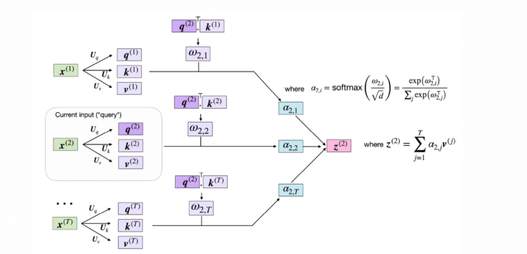
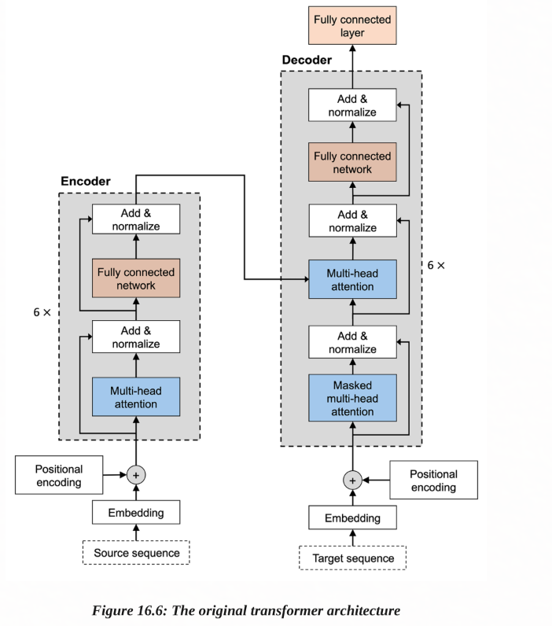
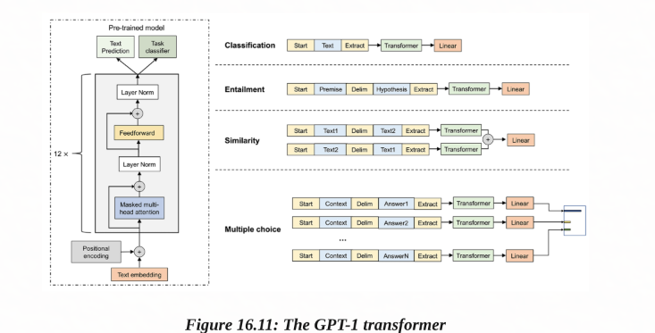
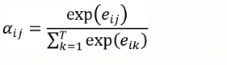
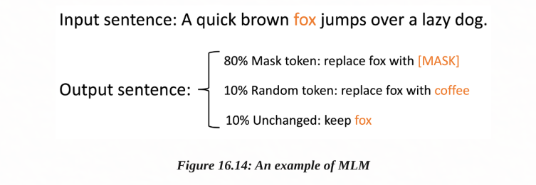

# Attention Mechanism and Transformer NLP

This project is a technical, notebook-based exploration of how neural language
models evolved from recurrent neural networks (RNNs) with attention to modern
transformer-based models. The notebooks move from the mathematical mechanics
of attention to practical language-model inference and BERT-family
fine-tuning.

## What this project covers

- Adding an attention mechanism to sequence models.
- Computing context-aware token representations with self-attention.
- Parameterizing attention with query, key, and value projections.
- Deriving scaled dot-product attention and understanding its numerical
  scaling.
- Connecting self-attention to multi-head attention and the original
  transformer encoder-decoder architecture.
- Comparing the development of GPT-1, GPT-2, and GPT-3.
- Using a pretrained GPT-2 model for transformer-based text processing.
- Fine-tuning a pretrained DistilBERT model for binary sentiment
  classification on the IMDB dataset.
- Understanding BERT masked-language-model pretraining and the role of
  bidirectional context.

## Technical workflow

### 1. Attention over sequence embeddings

[`attention_basic.ipynb`](attention_basic.ipynb) starts with token IDs and
learned embeddings implemented as PyTorch tensors. It calculates pairwise
compatibility scores, normalizes them with softmax, and forms context vectors
as weighted combinations of the sequence embeddings.

The notebook then introduces trainable projection matrices:

- **Query**: represents the token or position requesting information.
- **Key**: represents the information used for matching.
- **Value**: represents the content retrieved after matching.

For a query matrix \(Q\), key matrix \(K\), and value matrix \(V\), the core
scaled dot-product attention operation is:

```text
Attention(Q, K, V) = softmax(QKᵀ / √dₖ)V
```

where \(d_k\) is the key dimensionality. Scaling limits the magnitude of the
dot products and helps keep the softmax gradients useful during optimization.




## Self-attention

Self-attention allows each token to assign different weights to all other
tokens in the same sequence. Unlike a fixed-size local representation, the
resulting context vector is conditioned on the complete input sequence.




The following diagram provides a simplified view of the same operation:



## Parameterized scaled dot-product attention

The parameterized implementation projects the input embeddings into separate
query, key, and value spaces. This gives the model trainable transformations
for deciding which tokens should interact and what information should be
passed into the resulting context representation.


The computation of a context-aware embedding for an individual input element
is illustrated below:



## Transformer architecture

The transformer replaces recurrence with attention-based sequence processing.
Its main building blocks are stacked self-attention layers, position-wise
feed-forward networks, residual connections, layer normalization, and
positional information. Multi-head attention runs several attention
projections in parallel so the model can represent different relationships
between tokens.

The original encoder-decoder transformer architecture is based on
*Attention Is All You Need* by Vaswani et al. (2017):
<https://arxiv.org/abs/1706.03762>.



## Transformer language models

[`transformers.ipynb`](transformers.ipynb) demonstrates transformer model
usage with the Hugging Face Transformers library. It uses GPT-2 tokenization
and model APIs and returns PyTorch tensors for downstream processing.

| Model | Release year | Parameters | Training objective |
|---|---:|---:|---|
| GPT-1 | 2018 | 110 million | Generative pretraining |
| GPT-2 | 2019 | 1.5 billion | Unsupervised multitask language modeling |
| GPT-3 | 2020 | 175 billion | Few-shot language modeling |

Reference papers:

- GPT-1: [Improving Language Understanding by Generative Pre-Training](https://www.cs.ubc.ca/~amuham01/LING530/papers/radford2018improving.pdf)
- GPT-2: [Language Models are Unsupervised Multitask Learners](https://www.semanticscholar.org/paper/Language-Models-are-Unsupervised-Multitask-Learners-Radford-Wu/9405cc0d6169988371b2755e573cc28650d14dfe)
- GPT-3: [Language Models are Few-Shot Learners](https://arxiv.org/pdf/2005.14165.pdf)
- Sparse attention: [Generating Long Sequences with Sparse Transformers](https://arxiv.org/abs/1904.10509)



## BERT and contextual feature extraction

BERT uses bidirectional transformer encoders to learn representations from
both left and right context. Its masked-language-model objective hides input
tokens and trains the model to predict them from their surrounding context.
The notebooks describe the standard masking behavior:

- 80% of selected tokens are replaced with `[MASK]`.
- 10% are replaced with a random token.
- 10% remain unchanged.

The BERT architecture and pretraining objective are described in
[BERT: Pre-training of Deep Bidirectional Transformers for Language Understanding](https://arxiv.org/abs/1810.04805).






## IMDB sentiment fine-tuning

[`fine_tuning_bert.ipynb`](fine_tuning_bert.ipynb) and
[`api_fine_tuning_bert.ipynb`](api_fine_tuning_bert.ipynb) apply the concepts
to supervised text classification:

1. Tokenize IMDB review text with a pretrained transformer tokenizer.
2. Build PyTorch dataset and `DataLoader` objects for training, validation,
   and test splits.
3. Load `distilbert-base-uncased` with
   `DistilBertForSequenceClassification`.
4. Pass token IDs and attention masks through the model.
5. Optimize the classification head and pretrained parameters with Adam.
6. Disable gradient tracking during evaluation and select the class with the
   highest output logit.

The notebook records approximately 92% prediction accuracy on the IMDB
evaluation workflow.

## Technologies used

- **Python** for the notebooks and model experiments.
- **Jupyter Notebooks** for executable explanations, tensor experiments, and
  reproducible training workflows.
- **PyTorch** for tensors, embeddings, softmax attention, automatic
  differentiation, optimizers, datasets, data loaders, and model inference.
- **Hugging Face Transformers** for GPT-2 tokenization/model APIs,
  DistilBERT sequence classification, and the `Trainer`/training-argument
  interfaces.
- **Hugging Face Datasets utilities** for NLP dataset and evaluation-metric
  integration.
- **CUDA-compatible device execution** where available, with tensors and
  attention masks moved to the selected device for training and evaluation.

## References

- Bahdanau, Cho, and Bengio, [Neural Machine Translation by Jointly Learning to Align and Translate](https://arxiv.org/abs/1409.0473).
- Peters et al., [Deep Contextualized Word Representations](https://arxiv.org/abs/1802.05365).
- Vaswani et al., [Attention Is All You Need](https://arxiv.org/abs/1706.03762).
- Devlin et al., [BERT: Pre-training of Deep Bidirectional Transformers for Language Understanding](https://arxiv.org/abs/1810.04805).
- Qiu et al., [Pre-trained Models for Natural Language Processing: A Survey](https://arxiv.org/abs/2003.08271).
- Kayan et al., [AMMUS: A Survey of Transformer-based Pretrained Models in Natural Language Processing](https://arxiv.org/abs/2108.05542).
